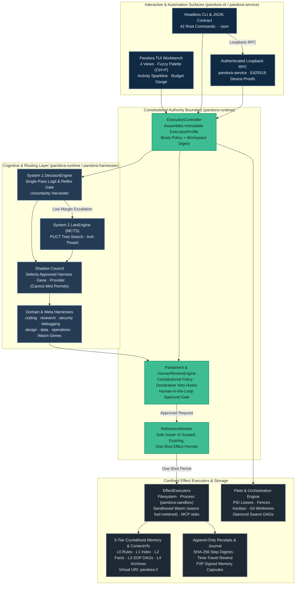
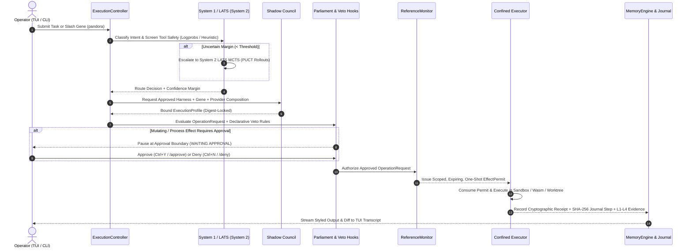
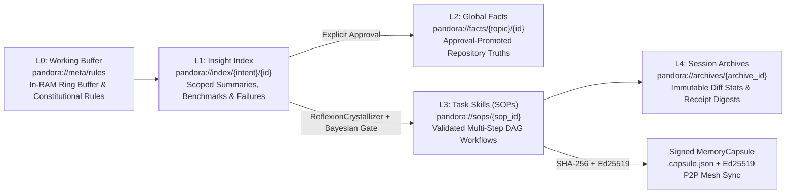
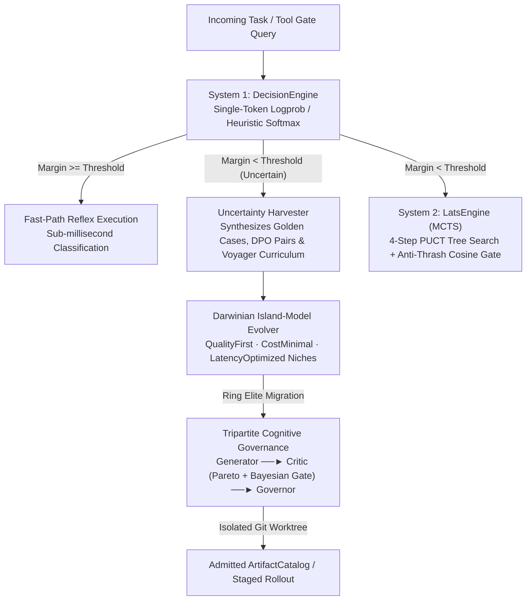

<p align="center">
  
</p>

# AGENT-PANDORA (`pandora`)

**Pandora** is a local-first, governed AI agent runtime and interactive terminal workbench written in Rust (`#![forbid(unsafe_code)]` across all runtime, CLI, provider, harness, and service crates).

Typing **`pandora`** in an interactive terminal immediately launches the full-screen **Pandora TUI**—a 4-view agentic mission control featuring a live multi-turn console, a 4-column Kanban & Fleet supervisor board, a 5-tier Hierarchical Memory & Context VFS inspector, a Tripartite Constitutional Governance & Supply-Chain Trust dashboard, and a Spotlight-style Fuzzy Command Palette (`Ctrl+P` / `F1`).

Every tool invocation, filesystem edit, process execution, WebAssembly Gene call, and subagent handoff passes through **one accountable, non-bypassable execution pipeline**:

```text
User / TUI / CLI  ──►  ExecutionController  ──►  Shadow Council  ──►  Parliament  ──►  ReferenceMonitor  ──►  EffectExecutor  ──►  Cryptographic Receipt
```

> **Status**: The active release identity is `3.0.0`. Releases follow strict semantic versioning, Ed25519 device trust, and verifiable execution receipts.

---

## System Architecture



---

## How Pandora Works: End-to-End Execution Lifecycle

Unlike standard agent wrappers that allow LLM tool calls to execute arbitrary shell commands directly, Pandora enforces strict separation between **selection** (`Shadow Council`), **policy/approval** (`Parliament`), **authorization** (`ReferenceMonitor`), and **execution** (`EffectExecutor`).



---

## Interactive TUI Workbench (`pandora`)

Running `pandora` with no arguments in an interactive terminal auto-initializes your local workspace configuration in `<1ms` and opens the **Ratatui Multi-View Workbench** immediately.

```mermaid
flowchart LR
    subgraph Header["Top Status Bar"]
        H1["PANDORA TUI Badge"]
        H2["Workspace View Tabs (Tab / Shift+Tab / Alt+1..4)"]
        H3["Typed Activity Badge (● IDLE / ◉ WORKING / ⚠ WAITING / ✔ SUCCESS)"]
    end

    subgraph Views["4 Interactive Workspace Views"]
        V1["1:Console<br/>• Styled Agent Transcript & Diffs (+ / - / @@)<br/>• Activity Cadence Sparkline<br/>• Turn Budget Gauge<br/>• Runtime Telemetry Sidebar (Ctrl+B)"]
        V2["2:Kanban & Fleet<br/>• 4-Column Kanban Board (BACKLOG / IN PROGRESS / BLOCKED / DONE)<br/>• Fleet Supervisor & Lease Telemetry<br/>• Token & Micro-Cost Accounting"]
        V3["3:Memory & Graph<br/>• 5-Tier Layered Memory (L0–L4) Architecture<br/>• Virtual Context FS (pandora://)<br/>• Daedalus / Argus / Debt Workflow Genes"]
        V4["4:Governance & Trust<br/>• Tripartite Constitutional Pillars<br/>• Admitted Packages (/packages)<br/>• Verified Distribution Cache (/distribution)<br/>• Live Approval Gate (Ctrl+Y / Ctrl+N)"]
    end

    subgraph Overlay["Modal & Composer Layer"]
        PAL["Spotlight Fuzzy Command Palette (Ctrl+P / F1)<br/>Instant Subsequence Filtering Across 35+ Commands & Provider Presets"]
        COMP["Readline Task Composer<br/>Ctrl+A/E/W/U/K · History (Up/Down) · Scrollbar (PageUp/PageDown)"]
    end

    Header --> Views
    Views --> Overlay
```



### TUI Keyboard Shortcuts & Built-In Slash Commands

| Shortcut / Command | Action |
| :--- | :--- |
| `pandora` | Immediately launch the full-screen Pandora TUI workbench |
| `Ctrl+P` / `F1` / `/palette` | Open the floating **Fuzzy Command Palette** modal overlay |
| `Ctrl+M` / `/model` | Open the interactive **Model & Provider Selector** picker modal |
| `Alt+B` / `/backdrop` | Cycle or set the TrueColor terminal mural background (`subtle`, `vivid`, `off`) |
| `Tab` / `Shift+Tab` / `Alt+1..4` | Switch between `1:Console`, `2:Kanban & Fleet`, `3:Memory & Graph`, and `4:Governance & Trust` |
| `Ctrl+B` / `/sidebar` | Toggle the live Telemetry, Sparkline & Turn Budget sidebar |
| `Ctrl+Y` / `/approve` | Immediately approve and resume a paused governed task |
| `Ctrl+N` / `/deny` | Immediately deny and abort a paused governed task |
| `PageUp` / `PageDown` / `Ctrl+Up/Down` | Scroll through the transcript with the visual scrollbar |
| `Ctrl+A` / `Ctrl+E` / `Ctrl+W` / `Ctrl+U` / `Ctrl+K` | Readline composer navigation and word/line deletion |
| `Ctrl+L` / `/clear` | Clear the console transcript buffer |
| `/login <provider>` / `/account` | OAuth 2.0 PKCE login flow and multi-account switching |
| `/provider add <name> <url>` | Add custom OpenAI-compatible endpoint with `--no-api-key` or `--api-key-stdin` |
| `/key` | Open the masked API key setup modal or save key to `.env` |
| `/setup <preset>` | Configure provider preset in-place (`ollama`, `openrouter`, `deepseek`, `openai`, `anthropic`, `groq`) |
| `/theme <auto\|dark\|light\|mono>` | Switch the TUI presentation palette live |
| `/kanban` / `/fleet-health` | Refresh the 4-column Kanban board and Fleet Supervisor telemetry snapshot |
| `/status`, `/diff`, `/test`, `/lint`, `/build` | Execute governed Coding Domain Genes directly from the composer |
| `/audit`, `/argus-review`, `/debt`, `/measure` | Execute architectural & code-quality Workflow Genes |

---

## Core Architectural Pillars

### 1. 5-Tier Crystallized Memory & Virtual Context Filesystem (`pandora://`)

Pandora replaces flat prompt stuffing with a **5-tier hierarchical memory engine** (`crates/pandora-runtime/src/memory_engine.rs`) backed by SQLite WAL and exposed through a deterministic virtual URI scheme (`ContextVfs`):



- **Strict Scope Isolation**: Every memory record is bound to `(tenant, workspace, session, provider)` and partitioned by intent (`repo`, `procedure`, `coding`, `user`).
- **Autonomous SOP Crystallization**: `ReflexionCrystallizer` abstracts workspace literals (`{{WORKSPACE_ROOT}}`, `{{COMMIT_SHA}}`, `{{TARGET_FILE}}`) from successful trajectories and promotes them to `L3` only when the **Bayesian Canary Gate** $\text{Beta}(1+k, 1+n-k)$ 95% lower credible bound exceeds the baseline pass rate.
- **P2P Signed Capsules**: Validated L3 SOPs export to `.capsule.json` and synchronize across sovereign nodes via `MeshSyncEngine` with a 3-point verification pipeline (SHA-256 digest, Ed25519 signature, and full DAG acyclicity check).

### 2. System 1 Reflex Logits, System 2 LATS MCTS & Tripartite Evolution



- **System 1 Non-Generative Decision Engine**: Classifies binary, choice, and score schemas over single-token logprobs (`Heuristic`, `Ollama`, `OpenAI-compatible`, `Mock` drivers) with temperature-calibrated Softmax.
- **Active-Learning Uncertainty Harvester & Voyager Curriculum**: Low-margin decisions are automatically harvested into executable `GoldenSuiteDefinition` suites, DPO pairs, and progressive `Easy / Medium / Hard` challenge curricula.
- **Darwinian Island-Model Genetic Evolver**: Evolving subpopulations (`QualityFirst`, `CostMinimal`, `LatencyOptimized`) run tournament selection, SOP step crossover, and ring elite migration to prevent premature convergence.
- **Tripartite Cognitive Governance**: Enforces strict separation between **Generator** (proposes in an isolated Git worktree), **Critic** (evaluates against the 3D `ParetoFrontier` and `BayesianCanaryGate`), and **Governor** (sole promotion authority; self-approval is cryptographically forbidden).

---

## Install & Quick Start

### One-Command Install & Launch

**Linux / macOS / WSL:**
```sh
# Latest release
curl -fsSL https://raw.githubusercontent.com/anisayakmitra-in/AGENT-PANDORA/main/scripts/install.sh | sh && "$HOME/.local/bin/pandora"

# Or pin to an exact version
curl -fsSL https://raw.githubusercontent.com/anisayakmitra-in/AGENT-PANDORA/main/scripts/install.sh | PANDORA_VERSION=v3.0.0 sh
```

**Windows PowerShell:**
```powershell
irm https://raw.githubusercontent.com/anisayakmitra-in/AGENT-PANDORA/main/scripts/install.ps1 | iex; & "$env:LOCALAPPDATA\Pandora\bin\pandora.exe"
```

### Build & Install from Source

Requires Rust `1.97.1`:

```sh
cargo install --path crates/pandora-cli --locked
pandora
```

### Configure a Model Provider

Configure a provider directly inside the TUI using `/setup <preset>` (or press `Ctrl+P` and type `setup`), or from the CLI:

```sh
pandora setup --preset ollama
pandora setup --preset openrouter
pandora setup --preset anthropic
pandora setup --preset openai
pandora setup --preset deepseek
pandora setup --preset groq
```

*(Pandora never stores plaintext API keys in `config.json`; credentials stay in your environment variables or the Argon2id + XChaCha20-Poly1305 encrypted local `SecretVault` via `pandora secret set`.)*

---

## Essential CLI Workflows

While `pandora` opens the interactive TUI by default in a terminal, all 42 root commands support deterministic headless execution and `--json` envelopes for CI and automation:

```sh
# Governed agent runs & coding workflows
pandora run --agent "Inspect workspace architecture and run tests"
pandora slash /audit
pandora slash /status

# OAuth 2.0 PKCE Login, Multi-Account Switching & Custom OpenAI/Anthropic Providers
pandora provider login --provider claude --no-browser
pandora provider login --provider openai --no-browser
pandora provider login --provider copilot --no-browser
pandora provider login --provider openrouter --no-browser
pandora provider login --provider ollama
printf '%s' "$MY_API_KEY" | pandora provider add my-api --base-url https://llm.example.com/v1 --model my-model-id --api-key-stdin --set-default
pandora provider add local-llm --base-url http://localhost:8080/v1 --model qwen2.5-coder --no-api-key --set-default
pandora provider accounts
pandora provider accounts use work --provider claude

# 5-Tier Memory, Virtual Context FS (pandora://), and Signed Capsules
pandora memory recall --tier l3 --intent coding
pandora memory vfs ls pandora://
pandora memory vfs cat pandora://meta/rules
pandora memory crystallize --all
pandora memory capsule export --sop sop-1 --output ./sop-1.capsule.json
pandora memory mesh sync --auto-promote

# Deterministic Time-Travel Journal Rewind, Forking & Diffing
pandora session rewind <session-id> --step 0 --yes
pandora session fork <session-id> --step 0 --prompt "Explore alternative patch"
pandora session diff <session-id> --step-a 0 --step-b 1

# System 1 Fast-Path Decisions, Uncertainty Harvesting & Golden Evaluations
pandora decision evaluate --question "Is this migration backwards-compatible?" --binary
pandora decision tool-gate --tool run_command --args '{"command":"rm -rf /"}'
pandora decision harvest --min-margin 0.35 --export-golden harvested_golden.json --dpo-export dpo.json
pandora evaluation golden --input harvested_golden.json

# Dynamic Diamond Swarm Synthesis & Multi-Agent Kanban
pandora orchestration synthesize --intent "Security audit and cache tuning" --roles "security_auditor,cache_specialist" --out plan.json
pandora kanban board
pandora fleet dashboard --json

# Darwinian Island-Model Evolution
pandora evolution island init --population 4 --out island_state.json
pandora evolution island run --state island_state.json --generations 5
```

---

## Workspace Crate Map

| Crate / Directory | Role & Responsibility |
| :--- | :--- |
| [`crates/pandora-types`](crates/pandora-types) | Canonical domain types, capability identifiers (`HarnessId`, `GeneId`, `ExecutionId`, `PermitId`), context provenance, and immutable `ExecutionProfile`. |
| [`crates/pandora-runtime`](crates/pandora-runtime) | Core governed runtime housing 30 specialized engines: `Parliament`, `ShadowCouncil`, `ReferenceMonitor`, `MemoryEngine` (L0–L4), `ContextVfs`, `DecisionEngine`, `LatsEngine`, `IslandModelEvolver`, `TripartiteGovernance`, `KanbanEngine`, `FleetEngine`, `WasmExecutor`, and SQLite WAL stores. |
| [`crates/pandora-harnesses`](crates/pandora-harnesses) | Built-in Domain Harnesses (`coding`, `research`, `design`, `security`, `debugging`, `data`, `operations`), `CoordinationMetaHarness`, and longest-match deterministic routing. |
| [`crates/pandora-provider`](crates/pandora-provider) | Multi-LLM provider transport (OpenAI, Anthropic, Ollama, OpenRouter, DeepSeek, Groq), token budget accounting, and classification-bound stable prefix caching. |
| [`crates/pandora-sandbox`](crates/pandora-sandbox) | Native OS confinement contract (Windows Job Objects + Restricted Tokens, Linux Landlock + seccomp-bpf, macOS Seatbelt). |
| [`crates/pandora-service`](crates/pandora-service) | Authenticated loopback JSON-RPC service daemon with Ed25519 device proofs, nonce replay protection, and role-based tenant isolation. |
| [`crates/pandora-cli`](crates/pandora-cli) | The `pandora` binary: 4-view Ratatui TUI workbench, line-oriented `chat`, and 42 structured CLI command surfaces. |
| [`sdk/`](sdk) | Copyable starter templates for [Domain Harnesses](sdk/domain-harness-starter/README.md), [Meta Harnesses](sdk/meta-harness-starter/README.md), and [WebAssembly Gene Packs](sdk/gene-pack/README.md). |
| [`npm/pandora-cli`](npm/pandora-cli) | Typed TypeScript client & checksum-verifying native binary launcher (`pandora-agent`). |

---

## Documentation Index

- **Architecture & Deep Dive**: [Runtime Architecture & Diagrams](docs/ARCHITECTURE.md) · [Why Pandora?](docs/WHY_PANDORA.md) · [Runtime Inventory](docs/INVENTORY.md)
- **CLI & Interfaces**: [CLI Reference](docs/CLI.md) · [JSON Automation Contract](docs/CLI_JSON.md) · [TypeScript Client](docs/TYPESCRIPT.md) · [Install Guide](docs/INSTALL.md) · [Platform Support](docs/PLATFORMS.md)
- **Memory, Graphs & Caching**: [5-Tier Memory & ContextVfs](docs/MEMORY.md) · [Prompt Caching](docs/PROMPT_CACHING.md) · [Graph Intelligence](docs/GRAPHS.md)
- **Evolution, Evaluation & Efficiency**: [Governed Evolution](docs/EVOLUTION.md) · [Evaluation Engine](docs/EVALUATION.md) · [Efficiency & Budgets](docs/EFFICIENCY.md)
- **Extensions & Sandboxing**: [Authoring Custom Harnesses & Genes](docs/CUSTOM_HARNESSES_AND_GENES.md) · [Harnesses](docs/HARNESSES.md) · [WebAssembly Genes](docs/WASM.md) · [Skills](docs/SKILLS.md) · [MCP Integration](docs/MCP.md)
- **Operations & Security**: [Multi-Agent Orchestration](docs/ORCHESTRATION.md) · [Fleet Supervisor](docs/FLEET.md) · [Production Readiness](docs/PRODUCTION.md) · [Adversarial Resilience](docs/ADVERSARIAL_RESILIENCE.md) · [Security Policy](SECURITY.md) · [Release Policy](RELEASES.md) · [Roadmap](docs/ROADMAP.md)

---

## License

Pandora is released under the [Apache License 2.0](LICENSE).
