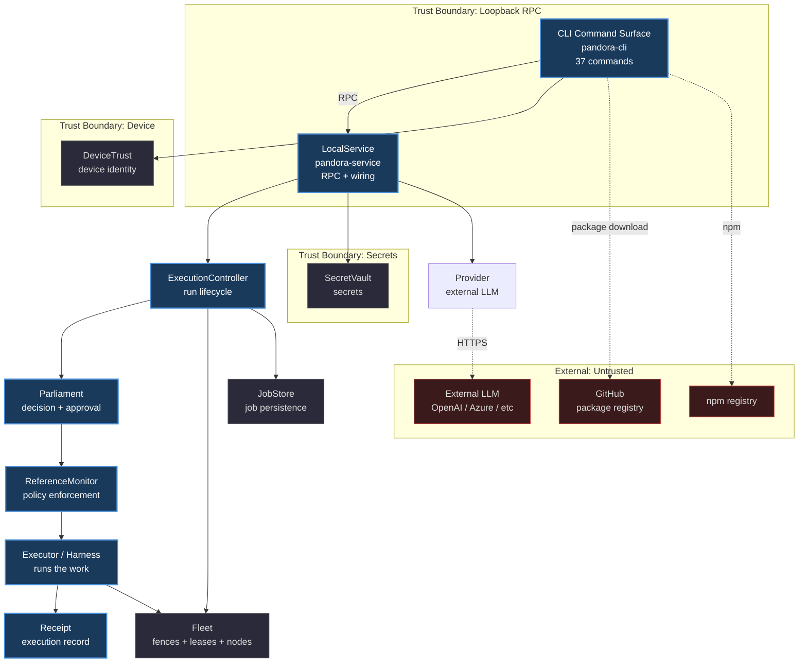

# Pandora Runtime Architecture

## High-level diagram



## Component cards

### CLI Command Surface
- **Role**: Entry point; 37 commands (setup, run, tui, job, subagent, package, memory, doctor, backup, restore, update, service, graph, fleet, ...)
- **Owns**: argument parsing, output formatting, human interaction
- **Trusts**: LocalService over authenticated loopback RPC
- **Does not**: execute work directly, hold secrets in plaintext

### LocalService
- **Role**: RPC service; wires the runtime together
- **Owns**: request routing, identity, RPC idempotency ledger, service token
- **Trusts**: ExecutionController, SecretVault, Provider
- **Does not**: make policy decisions, persist jobs

### ExecutionController
- **Role**: Run lifecycle; the start of the core chain
- **Owns**: execution id, harness/gene selection, status, run loop
- **Trusts**: Parliament, ReferenceMonitor, Fleet, JobStore
- **Does not**: decide approvals, enforce policy

### Parliament
- **Role**: Decision and approval
- **Owns**: approval decisions, human review gates
- **Trusts**: Approvals store, Human review
- **Does not**: execute work, persist state

### ReferenceMonitor
- **Role**: Policy enforcement
- **Owns**: policy version, permit TTL, authorization
- **Trusts**: Permit store, Policy context
- **Does not**: decide what to approve, execute work

### Executor / Harness
- **Role**: Runs the actual work
- **Owns**: harness execution, tool calls, gene application
- **Trusts**: Fleet (fences), Provider (inference)
- **Does not**: decide approvals, persist receipts

### Receipt
- **Role**: Execution record
- **Owns**: execution evidence, receipt id, completion status
- **Trusts**: nothing (terminal)
- **Does not**: mutate after creation

### Fleet
- **Role**: Fencing, leases, node registry
- **Owns**: fence acquire/renew/release/expire, lease renewal, node heartbeat, fence-operation registry
- **Trusts**: SQLite (WAL), trusted clock
- **Does not**: execute work, hold secrets

### JobStore
- **Role**: Job persistence
- **Owns**: job records, status transitions, SQLite sidecars
- **Trusts**: SQLite (WAL)
- **Does not**: decide job policy, execute work

### Provider
- **Role**: External LLM boundary
- **Owns**: client, failover, inference policy, structured output
- **Trusts**: external LLM endpoints
- **Does not**: hold secrets (receives them per-request), persist state

### SecretVault
- **Role**: Secrets isolation
- **Owns**: secret entries, zeroizing wrappers, exposure control
- **Trusts**: nothing (isolated)
- **Does not**: log, persist in plaintext, share across trust boundaries

### DeviceTrust
- **Role**: Device identity
- **Owns**: device key store, proof requests, attestation
- **Trusts**: OS keychain / TPM
- **Does not**: share keys across devices, persist in plaintext

## Primary path

```
CLI → LocalService → ExecutionController → Parliament → ReferenceMonitor → Executor → Receipt
```

1. **CLI** parses the command and opens an authenticated loopback RPC session
2. **LocalService** routes the request, checks identity, and starts the execution
3. **ExecutionController** acquires a fence, selects the harness/gene, and enters the run loop
4. **Parliament** decides whether the run needs approval; if so, it gates on human review
5. **ReferenceMonitor** enforces policy: permit TTL, policy version, authorization
6. **Executor** runs the work, calling the Provider for inference and the Fleet for fencing
7. **Receipt** records the execution evidence and completion status

## Trust boundaries

| Boundary | Inside | Outside | Enforcement |
| --- | --- | --- | --- |
| Loopback RPC | CLI, LocalService | network | authenticated loopback, service token |
| Secrets | SecretVault | everything else | zeroizing wrappers, no plaintext persistence |
| Device | DeviceTrust | other devices | OS keychain / TPM, attestation |
| External | Provider, GitHub client, npm | internet | HTTPS, no secrets in logs |

## External dependencies

- **External LLM** (OpenAI, Azure, etc.) — inference via Provider; untrusted content
- **GitHub** — package download; manifest + artifact
- **npm registry** — launcher and CLI distribution
- **crates.io** — Rust dependencies; audited by `cargo audit`

## Repository Layout and Crate Map

Pandora is organized as a Cargo workspace with strict crate boundaries:

| Path | Crate / Directory | Primary Role |
| :--- | :--- | :--- |
| `crates/pandora-types` | `pandora-types` | Canonical domain types, identifiers (`HarnessId`, `GeneId`, `ExecutionId`, `PermitId`), error models, and immutable `ExecutionProfile`. |
| `crates/pandora-runtime` | `pandora-runtime` | The central execution engine. Houses the 21 discrete engines, Parliament, Shadow Council, ReferenceMonitor, L0/L1/L2 memory, and SQLite state stores. |
| `crates/pandora-harnesses` | `pandora-harnesses` | Built-in domain harnesses (`coding`, `research`, `design`, `security`, `debugging`, `data`, `operations`), meta-coordination harness, and catalog routing. |
| `crates/pandora-provider` | `pandora-provider` | Multi-LLM provider abstraction (OpenAI, Gemini, Vertex AI, Anthropic), token usage tracking, and stable prefix caching. |
| `crates/pandora-sandbox` | `pandora-sandbox` | OS-level kernel confinement: Linux Landlock ABI + seccomp-bpf, Windows Job Objects + Restricted Tokens, and macOS sandbox-exec. |
| `crates/pandora-service` | `pandora-service` | Authenticated loopback IPC/RPC daemon service (`pandora-service`), session router, and token auth. |
| `crates/pandora-cli` | `pandora-cli` | The 37 public user-facing commands (`run`, `package`, `harness`, `memory`, `evolution`, `fleet`, `job`, `tui`, etc.). |
| `sdk/` | Extension Starters | Reference starter packages for [Domain Harnesses](../sdk/domain-harness-starter/README.md), [Meta Harnesses](../sdk/meta-harness-starter/README.md), and [Wasm Genes](../sdk/gene-pack/README.md). |
| `npm/pandora-cli` | TypeScript Launcher | npm distribution boundary, TypeScript client types, and cross-platform launcher. |
| `scripts/` | Verification & CI | Toolchain verification (`prepush.ps1`), repository validation (`validate_repo.py`), and documentation validation (`validate_docs.py`). |

## The 21 Runtime Engines

The core runtime (`crates/pandora-runtime/src/`) is composed of 21 discrete engines collaborating under strict governance:

| Engine | Source File | Core Responsibility | Downstream Collaboration |
| :--- | :--- | :--- | :--- |
| **`AdaptiveEngine`** | `src/adaptive_engine.rs` | Dynamically adapts execution strategies based on real-time task complexity. | Feeds `ExecutionController` |
| **`ContextEngine`** | `src/context_engine.rs` | Manages prompt context assembly and stable-prefix cache invalidation. | Coordinates with `pandora-provider` |
| **`EfficiencyEngine`** | `src/efficiency_engine.rs` | Enforces sample and token budget ceilings per target. | Tracks usage against `FleetBudget` |
| **`EvaluationEngine`** | `src/evaluation_engine.rs` | Executes golden sets, holdout suites, and produces deterministic scorecards. | Drives canary gates in `EvolutionEngine` |
| **`EvolutionEngine`** | `src/evolution.rs` | Governs self-evolution proposals across 4 rollout stages (Canary, Limited, Expanded, Complete). | Requires `Parliament` approval |
| **`FleetEngine`** | `src/fleet.rs` | Multi-process daemon supervisor, process fences, and atomic PID-bound leases. | Backs background worker jobs |
| **`GraphIntelligenceEngine`** | `src/graph_intelligence.rs`| Builds topological dependency graphs across code, memories, and artifacts. | Informs `ExecutionController` |
| **`HumanReviewEngine`** | `src/human_review.rs` | Collects, records, and gates operations requiring explicit human approval. | Resumes paused `Parliament` evaluations |
| **`MemoryEngine`** | `src/memory_engine.rs` | Synthesizes, recalls, and compacts L0, L1, and L2 memory records. | Backed by `sessions.rs` SQLite store |
| **`MutationEngine`** | `src/mutation.rs` | Proposes discrete mutations to prompts, genes, and workflows for evolution. | Submits to `EvolutionEngine` |
| **`ObservabilityEngine`** | `src/observability.rs` | Records structured trace spans, execution timelines, and audit logs. | Persists to local telemetry |
| **`OrchestrationEngine`** | `src/orchestration_engine.rs` | Orchestrates multi-agent execution DAGs and cross-repository roles. | Governed by `CoordinationMetaHarness` |
| **`ReplacementEngine`** | `src/replacement.rs` | Validates and activates replacement domain packages and canary rollbacks. | Enforces `CanaryPolicy` |
| **`SelfHealingEngine`** | `src/self_healing.rs` | Diagnoses runtime failures and derives bounded recovery plans. | Triggers `ContextRecovery` |
| **`SkillEngine`** | `src/skill_engine.rs` | Manages the dynamic installation, suspension, and isolation of agent skills. | Exposes skills to `ToolEngine` |
| **`ToolEngine`** | `src/tool_engine.rs` | Plans and validates tool invocations against schema definitions. | Submits `OperationRequest` to `Parliament` |
| **`WasmExecutor`** | `src/wasm.rs` | Sandboxed WebAssembly Gene runtime with fuel metering and memory caps. | Executes inside `pandora-sandbox` |
| **`ExecutionController`** | `src/execution_controller.rs`| Primary pipeline driver; coordinates task intake through receipt generation. | Connects CLI/Service to Parliament |
| **`ContentGuard`** | `src/content_guard.rs` | Detects prompt injection markers and quarantines untrusted tool outputs. | Pre-filters context before provider dispatch |
| **`RolloutReducer`** | `src/rollout_reducer.rs` | Deterministically reduces stage rollouts and evaluates stability thresholds. | Validates stage advancement in evolution |
| **`AgentLoop`** | `src/agent_loop.rs` | Multi-turn autonomous agent state machine with turn caps and checkpointing. | Drives tool turns within execution leases |

## Extending Pandora

Pandora is designed to be safely extended with custom Domain Harnesses, Meta Harnesses, and WebAssembly Genes without compromising core security invariants.

For complete authoring templates, manifest schemas, and CLI commands, see:
- [Authoring Custom Harnesses and Genes](CUSTOM_HARNESSES_AND_GENES.md)
- [Harness Packages Specification](HARNESSES.md)
- [WebAssembly Genes Specification](WASM.md)

