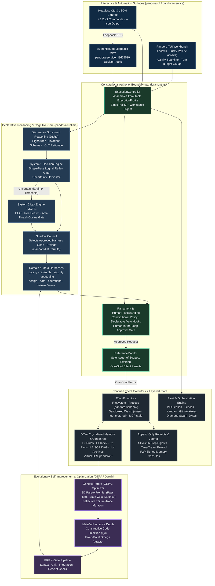
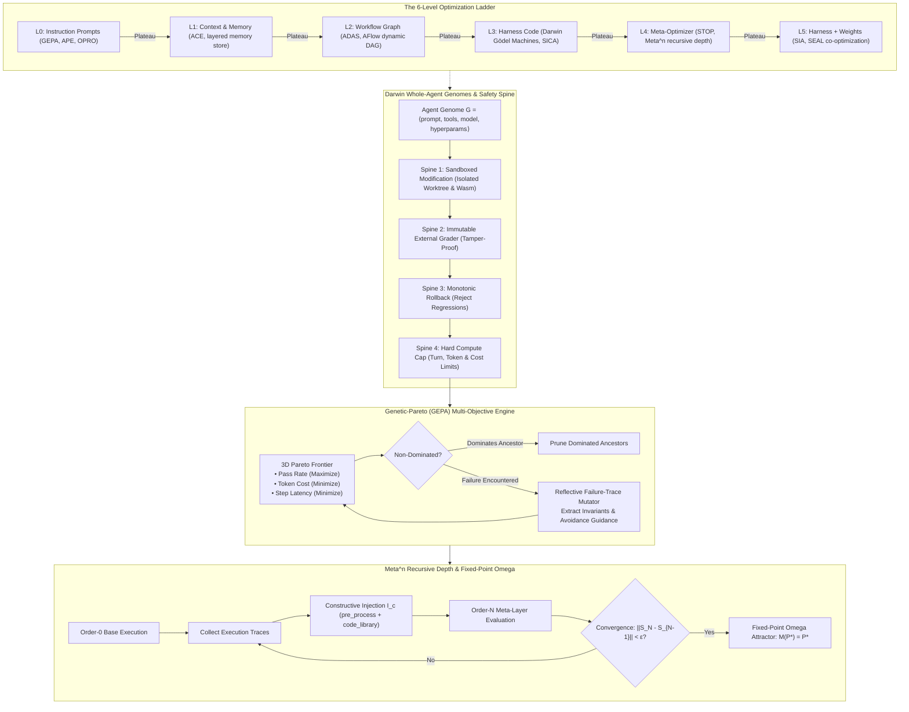
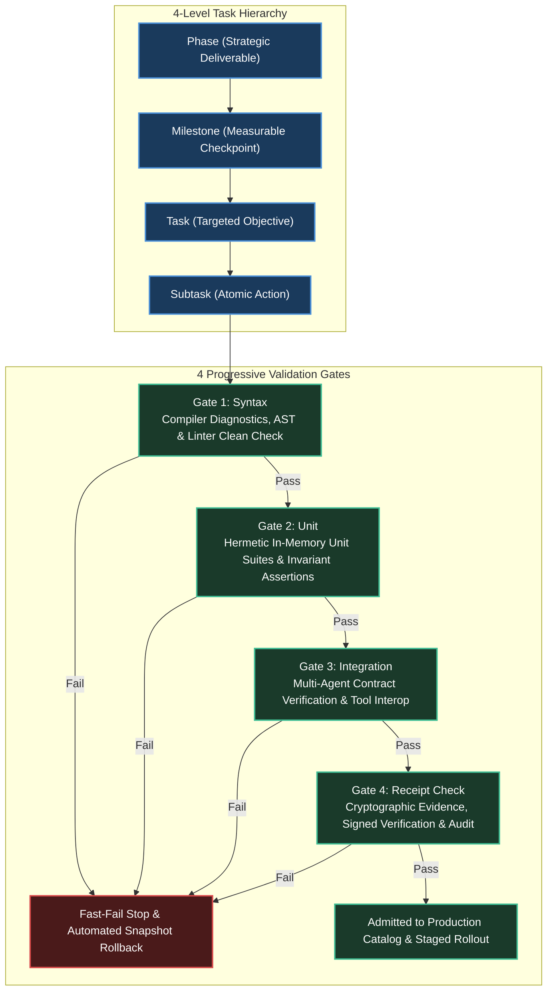
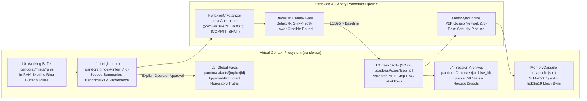

# Pandora Runtime Architecture

## High-Level System Topology (SUNLESS)



## End-to-End Governed Execution Sequence

```mermaid
sequenceDiagram
    autonumber
    actor Op as Operator (TUI / CLI)
    participant EC as ExecutionController
    participant DSR as DSR Signature & CoT Module
    participant S1 as DecisionEngine / LATS MCTS
    participant SC as ShadowCouncil
    participant PAR as Parliament & Veto Hooks
    participant RM as ReferenceMonitor
    participant EX as Confined Executor & Sandbox
    participant DB as SQLite WAL (Receipts, Journal & Memory)

    Op->>EC: Submit Task / Slash Gene (`pandora` or `pandora run`)
    EC->>DSR: Compile Task into Typed Signature with Invariants
    DSR->>DSR: Inject Rationale via Chain-of-Thought (`.into_chain_of_thought()`)
    DSR->>S1: Evaluate System 1 Logprob Reflex & Tool Safety Gate
    alt Uncertain Margin (< Calibrated Threshold)
        S1->>S1: Escalate to System 2 LATS MCTS (PUCT Rollouts + Anti-Thrash)
    end
    S1-->>EC: Validated Intent + Route Class + Confidence Margin
    EC->>SC: Request Approved Harness + Gene + Provider Composition
    SC-->>EC: Digest-Bound Immutable ExecutionProfile
    EC->>PAR: Submit OperationRequest for Constitutional Review
    alt Mutating / Process Effect Requires Human Approval
        PAR-->>Op: Pause Execution (⚠ WAITING APPROVAL)
        Op->>PAR: Approve (Ctrl+Y / /approve) or Deny (Ctrl+N / /deny)
    end
    PAR->>RM: Request Scoped Authorization
    RM-->>EX: Mint Scoped, Expiring, One-Shot EffectPermit
    EX->>EX: Verify Permit Digest & Execute in Confined Boundary (Process / Wasm / VFS)
    EX->>DB: Commit Cryptographic Receipt + SessionJournal Step + L1 Summary
    DB-->>Op: Return Verified Output, Receipts & Diffs
```

## Evolutionary Self-Improvement & GEPA Multi-Objective Engine



## Product Requirement Prompts (PRP) Pipeline



## Crystallized 5-Tier Memory & ContextVfs Virtual Topology



## Component cards

### TUI & CLI Command Surface
- **Role**: Primary interactive and headless entry point; bare `pandora` launches the 4-view Ratatui TUI workbench immediately, alongside 42 root CLI commands (`setup`, `run`, `tui`, `job`, `subagent`, `package`, `memory`, `doctor`, `backup`, `update`, `service`, `graph`, `fleet`, `kanban`, `decision`, `evolution`, `policy`, ...)
- **Owns**: argument parsing, output formatting, human interaction
- **Trusts**: LocalService over authenticated loopback RPC
- **Does not**: execute work directly, hold secrets in plaintext

### LocalService
- **Role**: RPC service; wires the runtime together
- **Owns**: request routing, identity, RPC idempotency ledger, service token
- **Trusts**: ExecutionController, SecretVault, Provider
- **Does not**: make policy decisions, persist jobs

### ExecutionController
- **Role**: Run lifecycle; the start of the core chain
- **Owns**: execution id, harness/gene selection, status, run loop
- **Trusts**: Parliament, ReferenceMonitor, Fleet, JobStore
- **Does not**: decide approvals, enforce policy

### Parliament
- **Role**: Decision and approval
- **Owns**: approval decisions, human review gates
- **Trusts**: Approvals store, Human review
- **Does not**: execute work, persist state

### ReferenceMonitor
- **Role**: Policy enforcement
- **Owns**: policy version, permit TTL, authorization
- **Trusts**: Permit store, Policy context
- **Does not**: decide what to approve, execute work

### Executor / Harness
- **Role**: Runs the actual work
- **Owns**: harness execution, tool calls, gene application
- **Trusts**: Fleet (fences), Provider (inference)
- **Does not**: decide approvals, persist receipts

### Receipt
- **Role**: Execution record
- **Owns**: execution evidence, receipt id, completion status
- **Trusts**: nothing (terminal)
- **Does not**: mutate after creation

### Fleet
- **Role**: Fencing, leases, node registry
- **Owns**: fence acquire/renew/release/expire, lease renewal, node heartbeat, fence-operation registry
- **Trusts**: SQLite (WAL), trusted clock
- **Does not**: execute work, hold secrets

### JobStore
- **Role**: Job persistence
- **Owns**: job records, status transitions, SQLite sidecars
- **Trusts**: SQLite (WAL)
- **Does not**: decide job policy, execute work

### Provider
- **Role**: External LLM boundary
- **Owns**: client, failover, inference policy, structured output
- **Trusts**: external LLM endpoints
- **Does not**: hold secrets (receives them per-request), persist state

### SecretVault
- **Role**: Secrets isolation
- **Owns**: secret entries, zeroizing wrappers, exposure control
- **Trusts**: nothing (isolated)
- **Does not**: log, persist in plaintext, share across trust boundaries

### DeviceTrust
- **Role**: Device identity
- **Owns**: device key store, proof requests, attestation
- **Trusts**: OS keychain / TPM
- **Does not**: share keys across devices, persist in plaintext

## Primary path

```
CLI → LocalService → ExecutionController → Parliament → ReferenceMonitor → Executor → Receipt
```

1. **CLI** parses the command and opens an authenticated loopback RPC session
2. **LocalService** routes the request, checks identity, and starts the execution
3. **ExecutionController** acquires a fence, selects the harness/gene, and enters the run loop
4. **Parliament** decides whether the run needs approval; if so, it gates on human review
5. **ReferenceMonitor** enforces policy: permit TTL, policy version, authorization
6. **Executor** runs the work, calling the Provider for inference and the Fleet for fencing
7. **Receipt** records the execution evidence and completion status

## Trust boundaries

| Boundary | Inside | Outside | Enforcement |
| --- | --- | --- | --- |
| Loopback RPC | CLI, LocalService | network | authenticated loopback, service token |
| Secrets | SecretVault | everything else | zeroizing wrappers, no plaintext persistence |
| Device | DeviceTrust | other devices | OS keychain / TPM, attestation |
| External | Provider, GitHub client, npm | internet | HTTPS, no secrets in logs |
| Workspace Operations | Filesystem Executor | host files | canonical path resolution, symlink checks, size limits |
| Native Process Execution | ProcessExecutor | child process | capability permits, argv verification, env scrubbing, bounded timeouts/costs; OS-level kernel confinement contract in progress (`pandora-sandbox`) |

### Process Execution & Sandboxing Posture

Pandora executes native processes (such as `cargo test` and `git status`) through the governed `ProcessExecutor`. The current execution boundary enforces:
- Exact one-shot effect permits issued by Parliament and verified by ReferenceMonitor.
- Strict argument and subprogram whitelisting; reject-closed traversal.
- Environment scrubbing (stripping API keys and secrets from child process environments).
- Bounded execution timeouts, output byte limits, and resource settlement.

OS-level kernel confinement backends (Linux Landlock/seccomp namespaces, Windows Job Objects/Restricted Tokens, and macOS Seatbelt) are specified in the `pandora-sandbox` contract and helper. Until the kernel confinement backends complete platform-specific verification, native execution relies on application-level capability and path governance.

## External dependencies

- **External LLM** (OpenAI, Azure, etc.) — inference via Provider; untrusted content
- **GitHub** — package download; manifest + artifact
- **npm registry** — launcher and CLI distribution
- **crates.io** — Rust dependencies; audited by `cargo audit`

## Repository Layout and Crate Map

Pandora is organized as a Cargo workspace with strict crate boundaries:

| Path | Crate / Directory | Primary Role |
| :--- | :--- | :--- |
| `crates/pandora-types` | `pandora-types` | Canonical domain types, identifiers (`HarnessId`, `GeneId`, `ExecutionId`, `PermitId`), error models, and immutable `ExecutionProfile`. |
| `crates/pandora-runtime` | `pandora-runtime` | The central execution engine. Houses the 30 discrete runtime engines, Parliament, Shadow Council, ReferenceMonitor, 5-layer crystallized memory (L0-L4), ContextVfs, System 1 DecisionEngine, LATS MCTS, and SQLite state stores. |
| `crates/pandora-harnesses` | `pandora-harnesses` | Built-in domain harnesses (`coding`, `research`, `design`, `security`, `debugging`, `data`, `operations`), meta-coordination harness, and catalog routing. |
| `crates/pandora-provider` | `pandora-provider` | Multi-LLM provider abstraction (OpenAI, Vertex AI, Anthropic, Ollama, DeepSeek), token usage tracking, and stable prefix caching. |
| `crates/pandora-sandbox` | `pandora-sandbox` | OS-level kernel confinement contract and verification protocol (specifications for Linux Landlock ABI + seccomp-bpf, Windows Job Objects + Restricted Tokens, and macOS Seatbelt; currently in contract-stage verification). |
| `crates/pandora-service` | `pandora-service` | Authenticated loopback IPC/RPC daemon service (`pandora-service`), session router, and token auth. |
| `crates/pandora-cli` | `pandora-cli` | The 4-view interactive Ratatui TUI workbench and 42 public user-facing CLI commands (`run`, `package`, `harness`, `memory`, `evolution`, `fleet`, `kanban`, `job`, `tui`, etc.). |
| `sdk/` | Extension Starters | Reference starter packages for [Domain Harnesses](../sdk/domain-harness-starter/README.md), [Meta Harnesses](../sdk/meta-harness-starter/README.md), and [Wasm Genes](../sdk/gene-pack/README.md). |
| `npm/pandora-cli` | TypeScript Launcher | npm distribution boundary, TypeScript client types, and cross-platform launcher. |
| `scripts/` | Verification & CI | Toolchain verification (`prepush.ps1`), repository validation (`validate_repo.py`), and documentation validation (`validate_docs.py`). |

## The 30 Runtime Engines

The core runtime (`crates/pandora-runtime/src/`) is composed of 30 discrete engines collaborating under strict governance:

| Engine | Source File | Core Responsibility | Downstream Collaboration |
| :--- | :--- | :--- | :--- |
| **`AdaptiveEngine`** | `src/adaptive_engine.rs` | Dynamically adapts execution strategies based on real-time task complexity. | Feeds `ExecutionController` |
| **`ContextEngine`** | `src/context_engine.rs` | Manages prompt context assembly and stable-prefix cache invalidation. | Coordinates with `pandora-provider` |
| **`ContextVfs`** | `src/context_vfs.rs` | Hierarchical virtual filesystem (`pandora://`) resolving L0-L4 memory, feature maps, and skills. | Provides selective hydration to `ContextEngine` |
| **`DecisionEngine`** | `src/decision_engine.rs` | Non-generative System 1 logprob/reflex engine with pluggable drivers (Heuristic, Ollama, OpenAI-compatible, Mock), schema DSL, and active learning uncertainty harvesting. | Pre-screens actions before `AgentLoop` |
| **`EfficiencyEngine`** | `src/efficiency_engine.rs` | Enforces sample and token budget ceilings per target. | Tracks usage against `FleetBudget` |
| **`EvaluationEngine`** | `src/evaluation_engine.rs` | Executes golden sets, holdout suites, and produces deterministic scorecards. | Drives canary gates in `EvolutionEngine` |
| **`EvolutionEngine`** | `src/evolution.rs` | Governs self-evolution proposals across 4 rollout stages (Canary, Limited, Expanded, Complete). | Requires `Parliament` approval |
| **`FleetEngine`** | `src/fleet.rs` | Multi-process daemon supervisor, process fences, and atomic PID-bound leases. | Backs background worker jobs |
| **`GraphIntelligenceEngine`** | `src/graph_intelligence.rs`| Builds topological dependency graphs across code, memories, and artifacts. | Informs `ExecutionController` |
| **`HumanReviewEngine`** | `src/human_review.rs` | Collects, records, and gates operations requiring explicit human approval. | Resumes paused `Parliament` evaluations |
| **`MemoryEngine`** | `src/memory_engine.rs` | Synthesizes, recalls, and compacts L0, L1, L2, L3, and L4 memory records, SOPs, and archives. | Backed by `sessions.rs` SQLite store |
| **`MutationEngine`** | `src/mutation.rs` | Proposes discrete mutations to prompts, genes, and workflows for evolution. | Submits to `EvolutionEngine` |
| **`ObservabilityEngine`** | `src/observability.rs` | Records structured trace spans, execution timelines, and audit logs. | Persists to local telemetry |
| **`OrchestrationEngine`** | `src/orchestration_engine.rs` | Orchestrates multi-agent execution DAGs, diamond topologies, and cross-repository roles. | Governed by `CoordinationMetaHarness` |
| **`ReplacementEngine`** | `src/replacement.rs` | Validates and activates replacement domain packages and canary rollbacks. | Enforces `CanaryPolicy` |
| **`SelfHealingEngine`** | `src/self_healing.rs` | Diagnoses runtime failures and derives bounded recovery plans. | Triggers `ContextRecovery` |
| **`SkillEngine`** | `src/skill_engine.rs` | Manages the dynamic installation, suspension, and isolation of agent skills. | Exposes skills to `ToolEngine` |
| **`ToolEngine`** | `src/tool_engine.rs` | Plans and validates tool invocations against schema definitions. | Submits `OperationRequest` to `Parliament` |
| **`WasmExecutor`** | `src/wasm.rs` | In-process sandboxed WebAssembly Gene runtime with fuel metering, instruction limits, and strict memory caps via `wasmi`. | Governed by `ReferenceMonitor` capability permits |
| **`ExecutionController`** | `src/execution_controller.rs`| Primary pipeline driver; coordinates task intake through receipt generation. | Connects CLI/Service to Parliament |
| **`ContentGuard`** | `src/content_guard.rs` | Detects prompt injection markers and quarantines untrusted tool outputs. | Pre-filters context before provider dispatch |
| **`RolloutReducer`** | `src/rollout_reducer.rs` | Deterministically reduces stage rollouts and evaluates stability thresholds. | Validates stage advancement in evolution |
| **`AgentLoop`** | `src/agent_loop.rs` | Multi-turn autonomous agent state machine with turn caps, anti-thrash tracking, and checkpointing. | Drives tool turns within execution leases |
| **`ReflexionCrystallizer`** | `src/reflexion.rs` | Parameterized literal abstraction and Bayesian canary gate verification for self-crystallizing L3 SOPs from past sessions. | Evaluates archives and auto-promotes to SQLite L3 |
| **`SessionJournalEngine`** | `src/session_journal.rs` | Deterministic differential turn snapshots, SHA-256 step digests, time-travel rewind, and Git worktree checkpoint forking. | Backed by `session_journal_steps` in SQLite |
| **`MeshSyncEngine`** | `src/mesh_sync.rs` | Decentralized P2P gossip capsule synchronization, Ed25519 identity exchange, and strict 3-point security verification (SHA-256, Ed25519, DAG acyclicity). | Synchronizes capsules across local and peer meshes |
| **`LatsEngine`** | `src/lats_engine.rs` | Language Agent Tree Search (LATS) MCTS engine with PUCT selection, budget enforcement, and System 1 -> System 2 escalation gate. | Escalation path for uncertain decisions |
| **`ReflexionDiagnosticEngine`**| `src/reflexion.rs` | Semantic failure classification (Compiler, Test, Tool, Assertion) producing actionable root cause, invariant, and avoidance guidance. | Informs `CodingFeedbackLoop` self-healing |
| **`VoyagerCurriculum`** | `src/voyager_curriculum.rs`| Synthesizes progressive difficulty challenge suites (Easy/Medium/Hard) from harvested uncertain decision records. | Outputs `GoldenSuiteDefinition` for evaluation |
| **`TripartiteGovernance`** | `src/tripartite_governance.rs`| Tripartite Cognitive Governance enforcing separation of Generator, Critic, and Governor roles with Pareto and Bayesian canary gates. | Governs self-improvement proposal promotion |

### System 1 Decision & Reflex Engine

The `DecisionEngine` (`crates/pandora-runtime/src/decision_engine.rs`) introduces an open-source non-generative paradigm inspired by fast-path logit classifiers. Rather than generating variable-length text responses with auto-regressive decoding, System 1 actions are classified directly over single-token logprobs and discrete candidate schemas:

1. **Schema DSL**: Defines strict question contracts (`QuestionSchema::Binary`, `QuestionSchema::Choice`, `QuestionSchema::Score`) ensuring only declared valid labels can be evaluated.
2. **Pluggable Drivers (`DecisionDriver`)**:
   - `HeuristicDecisionDriver`: Pure local, sub-millisecond regex and semantic logit evaluation with zero network overhead.
   - `OllamaDecisionDriver`: Formats a single-token prompt querying local Ollama `/api/generate` instances with temperature calibration.
   - `CustomApiDecisionDriver`: Interfaces with OpenAI-compatible `/v1/chat/completions` endpoints requesting `logprobs: true` and extracting candidate probabilities from top logprob distributions.
   - `MockDecisionDriver`: FIFO queue for deterministic unit test assertions and replaying edge cases.
3. **Calibrated Confidence & Softmax**: Extreme logits are normalized via numerically stable Softmax with max-logit subtraction, followed by temperature scaling and confidence margin calculation (top-1 minus top-2 probability).
4. **Active-Learning Uncertainty Harvester & Golden Dataset Synthesis (Hermes-inspired)**: Decisions falling below the calibrated confidence margin threshold (`--min-margin <float>`) are automatically harvested as `DecisionEvolutionRecord` items. The engine directly synthesizes:
   - `GoldenSuiteDefinition` & `GoldenEvaluationCase`: Validated evaluation suites consumable directly by `pandora evaluation golden` without manual annotation.
   - `DpoPair`: Direct Preference Optimization pairs (`prompt`, `chosen`, `rejected`, `margin`) for downstream alignment.
   - `FineTuningSample`: Supervised fine-tuning prompt/completion pairs with calibrated sample weights.

### Darwinian Island-Model Multi-Population Genetic Evolver

Inspired by Darwinian multi-agent evolver architectures, the `IslandModelEvolver` (`crates/pandora-runtime/src/evolution.rs`) eliminates single-population premature convergence through isolated subpopulations across distinct niches:

1. **Niche Specialization**:
   - `QualityFirst`: Prioritizes pass rate and rigorous verification above all else.
   - `CostMinimal`: Enforces minimal token cost and lean execution pathways.
   - `LatencyOptimized`: Optimizes execution speed and minimized step latency.
2. **Genetic Operators**:
   - **Tournament Selection**: K-candidate tournament selection picking top fitness performers within each niche.
   - **SOP Step Crossover**: Recombines Standard Operating Procedure steps from two parent procedures while preserving trigger intent and step ordering.
   - **Mutation Operators**: Contextual prompt mutations, step reordering, and verification checkpoint insertion.
3. **Ring Elite Migration**: Periodic migration of top elite candidates across a unidirectional ring topology (`QualityFirst` -> `CostMinimal` -> `LatencyOptimized` -> `QualityFirst`), injecting high-fitness genetic diversity without homogenizing niches.
4. **Pareto Frontier Generation**: Tracks global non-dominated solutions across the three competing objectives (pass rate, token cost, and latency ms).

### Dynamic Emergent Swarm Topology Synthesis

Inspired by OpenViking dynamic agent architectures, the `OrchestrationEngine` (`crates/pandora-runtime/src/orchestration_engine.rs`) compiles natural language architectural intent into validated Diamond execution DAGs:

1. **Topology Synthesis**:
   - **Planner (`coordination-meta`)**: Root node establishing execution scope and task partitioning.
   - **Parallel Specialist Roles (`domain-specialist`)**: Concurrently executed domain roles inferred from task intent (e.g. security auditors, cache specialists, load testers).
   - **Synthesizer (`synthesis-domain`)**: Aggregates and merges multi-role outputs into a coherent artifact candidate.
   - **Canary Verification Gate (`verification-meta`)**: Downstream verification checkpoint asserting quality gates prior to execution commit.
2. **Contract Safety & Cross-Domain Coordination**:
   - Every synthesized plan validates DAG acyclicity, bounded parallelism, and bounded handoffs.
   - Cross-domain handoffs between distinct harnesses are strictly coordinated through declared Meta Harness routing.

### Autonomous Reflexion & Memory Self-Crystallization

The `ReflexionCrystallizer` (`crates/pandora-runtime/src/reflexion.rs`) automatically distills proven multi-turn trajectories from completed sessions into reusable, high-confidence Standard Operating Procedures (SOPs):

1. **Parameterized Literal Abstraction**: Replaces fragile workspace-specific strings, UUIDs, Git commit hashes, and SHA-256 digests with parameterized placeholders (`{{WORKSPACE_ROOT}}`, `{{COMMIT_SHA}}`, `{{SESSION_ID}}`, `{{SHA256_DIGEST}}`, `{{TARGET_FILE}}`), ensuring crystallizations generalize cleanly across workspaces.
2. **Bayesian Canary Gate Verification**: Evaluates candidate SOP reliability against a Beta(1 + passes, 1 + failures) distribution. Candidates whose 95% credible lower bound strictly exceeds the baseline pass rate are promoted.
3. **Durable L3 SQLite Promotion**: Promoted SOPs are committed to SQLite L3 storage (`memory_sops`) and become immediately queryable via `pandora memory sop list` and usable in autonomous execution loops via `pandora evolution loop`.

### Deterministic Time-Travel Replay & Checkpoint Forking

The `SessionJournalEngine` (`crates/pandora-runtime/src/session_journal.rs`) provides time-travel capabilities for debugging and exploring alternative execution paths:

1. **Differential Step Digests**: Each turn records tool invocations, arguments, results, workspace git diffs, and environment state, bound cryptographically by a SHA-256 step digest.
2. **State Rewind (`pandora session rewind`)**: Rolls back session state and truncates subsequent journal entries in SQLite back to any chosen prior step index `k`, restoring environment variables and working directory state.
3. **Worktree Checkpoint Forking (`pandora session fork`)**: Spawns an isolated Git worktree branching from step `k` to test alternative prompts or model pathways without disturbing the parent session.
4. **Step Diffing (`pandora session diff`)**: Computes structural and semantic diffs between any two historical journal steps `m` and `n`.

### Decentralized P2P Capsule Mesh Synchronization

The `MeshSyncEngine` (`crates/pandora-runtime/src/mesh_sync.rs`) enables sovereign agent nodes to exchange evolutionary memories and SOP capsules across a peer-to-peer gossip network:

1. **Cryptographic Identity & Handshake**: Nodes generate Ed25519 keypairs and sign timestamped handshake envelopes declaring listen addresses and mesh capabilities.
2. **Signed Evolutionary Capsules**: SOPs are packaged into signed `SignedCapsulePackage` structures containing author public keys and Ed25519 signatures over the canonical capsule SHA-256 digest.
3. **Strict 3-Point Security Pipeline**: Every received capsule package must pass:
   - SHA-256 digest integrity verification.
   - Author Ed25519 cryptographic signature verification.
   - Complete DAG acyclicity check across both SOP step dependencies and capsule ancestry lineage.
4. **Gossip Broadcast & Synchronization**: CLI commands (`pandora memory mesh peers`, `broadcast`, `sync`) discover local mesh capsules and support optional auto-promotion into local L3 SQLite memory storage.

### Language Agent Tree Search (LATS) & MCTS Engine

The `LatsEngine` (`crates/pandora-runtime/src/lats_engine.rs`) implements Monte Carlo Tree Search over multi-step agent actions, tool sequences, and gene modifications:

1. **PUCT Path Selection**: Balances exploitation of known high-value paths with exploration of high-prior branches:
   $$U(s, a) = Q(s, a) + c_{\text{puct}} \cdot P(a \mid s) \cdot \frac{\sqrt{\sum_b N(s, b)}}{1 + N(s, a)}$$
   where $P(a \mid s)$ is the calibrated softmax prior produced by the System 1 fast-path logit engine.
2. **Deterministic 4-Step MCTS Loop**:
   - **Selection**: Traverses from root to an unexpanded or leaf node via PUCT.
   - **Expansion**: Instantiates child nodes corresponding to available candidate actions.
   - **Leaf Simulation**: Evaluates leaf state value via caller-supplied heuristic without recursive LLM generation.
   - **Backpropagation**: Propagates leaf rewards up the trajectory tree, updating visit counts and value sums.
3. **Budget Ceilings**: Governed strictly by `StrategyBudget`, enforcing maximum rollouts, tree depth, token budgets, tool count, and duration.
4. **System 1 -> System 2 Escalation Gate**: When a fast reflex decision's margin falls below the uncertainty threshold, execution transparently escalates to System 2 MCTS exploration.
5. **Anti-Thrash Terminal Safety**: Evaluates cosine similarity between successive action trajectories, forcing loop termination with `ConvergenceChoice::Stuck` when oscillations occur.

### Deep Reflexion Diagnostic Engine & Voyager Curriculum

Combining linguistic error feedback with progressive capability synthesis:

1. **Reflexion Diagnostic Engine (`ReflexionDiagnosticEngine`)**:
   - Analyzes raw execution failure traces (rustc compiler errors, test failures, panics, tool contract errors, assertion failures).
   - Classifies failures into typed categories (`ReflexionFailureKind::Compiler`, `Test`, `Tool`, `Assertion`, `Unknown`).
   - Extracts structured semantic deltas: exact invariant violated, root cause snippet, avoidance guidance, and severity (1 to 5).
   - Feeds directly into `CodingFeedbackLoop` to synthesize self-healing recovery candidates.
2. **Voyager Automatic Curriculum Generator (`VoyagerCurriculum`)**:
   - Mines harvested decision records where the decision margin was narrow.
   - Assigns progressive difficulty levels (`CurriculumDifficulty::Easy`, `Medium`, `Hard`) based on decision entropy and margin.
   - Generates deterministic `GoldenSuiteDefinition` files consumable by `pandora evaluation golden`.
3. **Signed Memory Capsule Crystallization**:
   - Auto-promotes verified crystallized SOPs into cryptographically signed `MemoryCapsule` packages with SHA-256 digests and author provenance.

### Tripartite Cognitive Governance & Worktree Isolation

The `TripartiteGovernance` orchestrator (`crates/pandora-runtime/src/tripartite_governance.rs`) enforces strict separation of concerns for recursive self-modification:

1. **Tripartite Role Separation**:
   - **Generator**: Formulates and submits self-modification proposals (`TripartiteProposal`).
   - **Critic**: Evaluates proposals against objective benchmarks and empirical verifiers (`TripartiteEvaluation`).
   - **Governor**: Holds sole approval and promotion authority (`TripartiteApproval`).
2. **Universal Self-Approval Invariant**:
   - The proposer role (`Generator`) is strictly prohibited from approving its own modifications (`TripartiteError::SelfApprovalForbidden`).
3. **Multi-Objective Pareto & Bayesian Canary Verification**:
   - The Critic evaluates candidates against the multi-objective `ParetoFrontier` (pass rate, token cost, step latency ms). Dominated candidates are rejected immediately (`TripartiteError::ParetoDominated`).
   - Candidate proposals must pass `BayesianCanaryGate` evaluation, requiring the Beta distribution 95% lower credible bound ($\text{LCB}_{95}$) to exceed the baseline pass rate.
4. **Isolated Git Worktree Branch Derivation**:
   - `branch_name_for_proposal` derives isolated Git worktree branch names (`experiment/<role>-<id>`) ensuring competing evolutionary proposals never mutate the active working tree until full promotion.

## Extending Pandora

Pandora is designed to be safely extended with custom Domain Harnesses, Meta Harnesses, and WebAssembly Genes without compromising core security invariants.

For complete authoring templates, manifest schemas, and CLI commands, see:
- [Authoring Custom Harnesses and Genes](CUSTOM_HARNESSES_AND_GENES.md)
- [Harness Packages Specification](HARNESSES.md)
- [WebAssembly Genes Specification](WASM.md)

