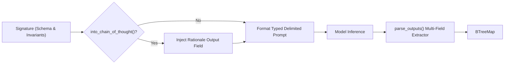

# Declarative Structured Reasoning (DSRs) & Genetic-Pareto Optimization (GEPA)

Pandora natively implements **Declarative Structured Reasoning (DSRs)**—a high-performance, `#![forbid(unsafe_code)]` Rust synthesis of the DSPy paradigm—coupled with the **Genetic-Pareto (GEPA)** reflective optimization engine.

---

## 1. Declarative Structured Reasoning (DSRs)

Rather than fragile string concatenation or hardcoded LLM prompts, DSRs abstracts reasoning tasks into typed **Signatures**, **Predictors**, and **Modules**.

### Architecture



### Core Abstractions (`pandora-types::dsrs`)

1. **`SignatureField`**: Defines an input or output boundary with automatic capitalization prefixing (`Code:`, `Verdict:`).
2. **`Signature`**: Encapsulates system instructions, input requirements, output schemas, and few-shot `DsrDemonstration` exemplars.
3. **`Chain-of-Thought (CoT)`**: `.into_chain_of_thought()` automatically injects a `rationale` field before output fields, enforcing step-by-step reasoning justification before answering.
4. **Delimited Output Parsing**: Robust parsing of single-field and multi-field outputs using header delimiters that fail-closed if required fields are missing.

### Built-in Signatures
- **`CodeReviewer`**: Inputs (`code`, `context`) $\to$ Outputs (`verdict`, `feedback`).
- **`ReActModule`**: Inputs (`task`, `observations`) $\to$ Outputs (`thought`, `action`).
- **`SqlSynthesizer`**: Inputs (`question`, `schema`) $\to$ Outputs (`sql`).

---

## 2. Genetic-Pareto Optimization (GEPA)

**GEPA** optimizes system instructions and declarative signatures using natural language execution feedback traces rather than sparse scalar reinforcement learning rewards.

### Multi-Objective Pareto Frontier

Instead of collapsing performance to an arbitrary single scalar, `GepaParetoFrontier` evaluates candidates across 3 orthogonal dimensions:
- **Pass Rate (`pass_rate`)**: $0.0 \dots 1.0$ (maximize)
- **Token Cost (`token_cost`)**: Total tokens consumed (minimize)
- **Step Latency (`latency_ms`)**: Wall-clock duration in milliseconds (minimize)

A candidate $A$ strictly dominates $B$ ($A \succ B$) iff:

$$\text{pass\_rate}(A) \ge \text{pass\_rate}(B) \;\land\; \text{tokens}(A) \le \text{tokens}(B) \;\land\; \text{latency}(A) \le \text{latency}(B)$$

and $A$ is strictly superior in at least one dimension.

### Reflective Trace Mutation

When a candidate fails holdout evaluation tasks:
1. `GepaFeedbackTrace` records the failure (`task_id`, `input_summary`, `failed_output`, `diagnostic`, and `root_cause`).
2. `GepaReflectiveMutator` synthesizes actionable avoidance invariants and appends them directly into the signature's system instructions.
3. The newly mutated candidate is probed on verification suites.
4. If non-dominated, it is inserted into the Pareto frontier and any dominated ancestors are automatically pruned.

---

## 3. CLI & TUI Surfaces

### CLI Commands
```bash
# List available declarative reasoning signatures
pandora dsrs show

# Inspect fields and schema of a specific signature
pandora dsrs inspect CodeReviewer

# View Chain-of-Thought (CoT) transformation
pandora dsrs cot CodeReviewer

# Inspect non-dominated GEPA Pareto frontier
pandora gepa frontier

# Run a reflective GEPA optimization round
pandora gepa optimize
```

### TUI Workbench
- `/dsrs`: Inspect active Declarative Structured Reasoning signatures in the console.
- `/gepa`: Inspect the Genetic-Pareto multi-objective frontier and optimization state.
- Available directly from the Spotlight Command Palette (`Ctrl+P` / `F1`).
