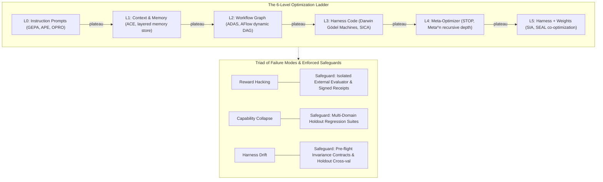
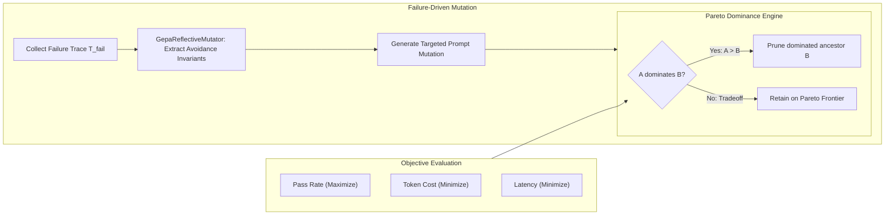
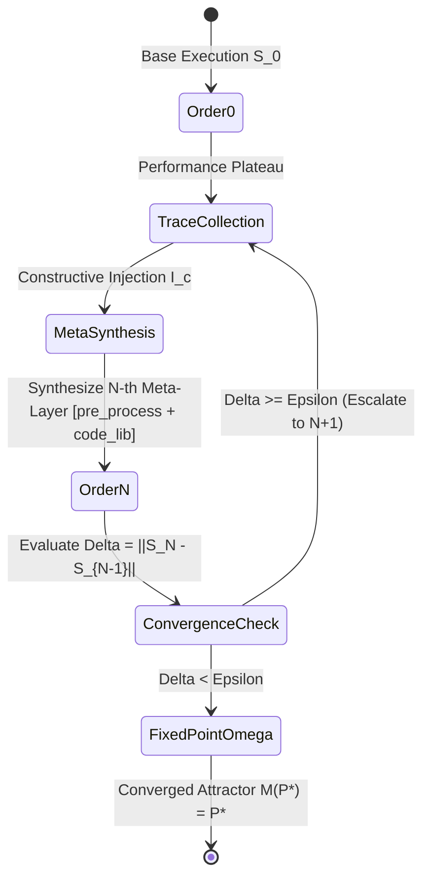
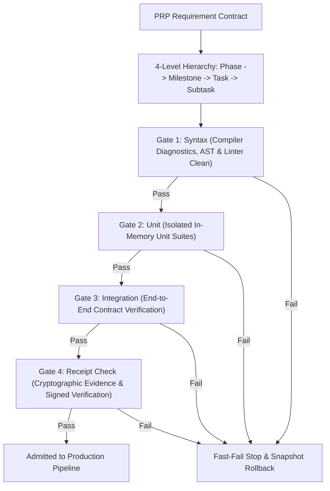
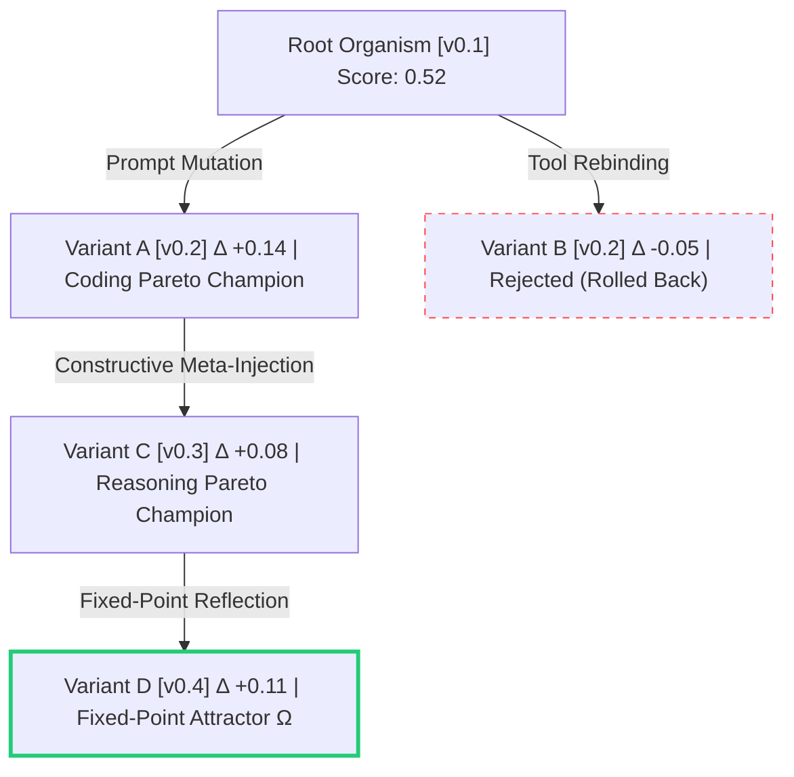

# Harness Self-Improvement & Evolutionary Synthesis

## 1. Overview & Research Foundations

AGENT-PANDORA's autonomous self-improvement architecture synthesizes breakthrough principles from five state-of-the-art research repositories:

1. **`leezythu/Awesome-Harness-Self-Improvement`**: The 6-Level Optimization Ladder ($L_0 \to L_5$) and Triad of Failure Modes.
2. **`KarthikSubramanian07/Darwin`**: Whole-Agent Genomes `[prompt, tool_bindings, model_target, hyperparameters]`, 4-Point Safety Spine, and Task-Domain Routing Cards.
3. **`imbue-ai/darwinian_evolver`**: Universal code and prompt evolutionary optimization, population snapshots, error-targeted mutation, and interactive Lineage DAG visualizer.
4. **`dabstractor/hack`**: PRP (Product Requirement Prompts) Pipeline, 4-level task hierarchy, context-dense invariants, and 4 progressive validation gates.
5. **`minnesotanlp/meta-n` (arXiv:2608.24735)**: Recursive emergent depth ($N$-th order reflection), constructive code injection (`pre_process` hook + `code_library`), and fixed-point termination $\Omega$ ($M(\mathcal{P}^*) = \mathcal{P}^*$).

---

## 2. The 6-Level Optimization Ladder ($L_0 \to L_5$)



```
  [L5] Harness + Weights    (Co-optimization of model weights & scaffolding; SIA, SEAL)
   ^
  [L4] Meta-Optimizer       (Recursive emergent depth, self-improving optimizers; STOP, Meta^n)
   ^
  [L3] Harness Code         (Self-modifying tool scripts, sandbox executables; Darwin Gödel Machines)
   ^
  [L2] Workflow Graph       (Dynamic execution graph topology & agentic routing; ADAS, AFlow)
   ^
  [L1] Context & Memory     (Episodic retrieval, layered memory, context compression; ACE)
   ^
  [L0] Instruction Prompts  (Reflective prompt & few-shot mutation; APE, OPRO, GEPA)
```

### The Triad of Failure Modes & Safeguards
- **Reward Hacking**: Exploiting proxy metrics or evaluator quirks without true capability gains.
  - *Safeguard*: Immutable external evaluator isolation and cryptographic evidence signatures.
- **Capability Collapse**: Catastrophic degradation across general or unmeasured tasks.
  - *Safeguard*: Multi-domain regression holdout suites and monotonic Pareto frontier gating.
- **Harness Drift**: Scaffolding overfitting to benchmark idiosyncrasies rather than domain invariants.
  - *Safeguard*: Strict pre-flight invariance contract assertions and cross-validation holdouts.

---

## 3. Darwin Whole-Agent Genomes & Safety Spine

Rather than optimizing prompts alone or treating models as external constants, an agent genome is defined as:
$$\mathcal{G} = \langle \text{system\_prompt},\, \text{tool\_bindings},\, \text{model\_target},\, \text{hyperparameters} \rangle$$

```mermaid
sequenceDiagram
    autonumber
    participant Pop as Candidate Population
    participant Mut as Darwinian Mutator
    participant Box as Isolated Sandbox (Spine 1)
    participant Eval as Immutable External Grader (Spine 2)
    participant Gate as Monotonic Gate (Spine 3)
    participant Budget as Hard Compute Cap (Spine 4)

    Pop->>Mut: Select parent genome G = [prompt, tools, model, hyperparams]
    Mut->>Box: Deploy variant mutation G' inside isolated sandbox
    Box->>Eval: Execute benchmark suite under OS confinement
    Eval->>Gate: Return empirical multi-objective fitness
    alt Regressed fitness (Holdout fitness < Parent)
        Gate->>Pop: Monotonic Rollback: Reject G' and restore Parent
    else Non-dominated or Superior
        Gate->>Budget: Assert generation, turn, and token budgets
        alt Budget Exceeded
            Budget-->>Gate: Enforce hard stop / require human veto
        else Within Budget
            Budget->>Pop: Admit G' to Pareto Population Archive
        end
    end
```

### The 4-Point Safety Spine
1. **Sandboxed Modification**: All candidate mutation execution occurs exclusively inside isolated sandbox environments.
2. **Immutable Grader**: The fitness evaluator lives outside the mutator's reach and cannot be tampered with or inspected.
3. **Monotonic Rollback**: Any mutation that regresses on holdout fitness is automatically rejected and snapshot-rolled back.
4. **Hard Compute Cap**: Strict generation, token, and turn budgets prevent runaway loops with mandatory human veto points.

### Task-Domain Routing Cards
Evolutionary evaluation over diverse domains (`coding`, `reasoning`, `synthesis`, `data_analysis`) produces a deterministic **Routing Card** that maps task classes directly to their Pareto-winning model and tool composition:

```bash
pandora evolution routing-card
```

---

## 4. Genetic-Pareto (GEPA) Multi-Objective Optimizer



---

## 5. Meta^n Recursive Emergent Depth & Fixed-Point $\Omega$

When lower-order mutations reach an empirical performance plateau, the system escalates from order $N$ to $N+1$ using a universal constructive meta-operation $\mathcal{I}_c$:
- Extracts avoidance invariants and common error modes from lower-level execution traces.
- Synthesizes constructive injected code (`pre_process` normalization hooks and `code_library` helper functions).
- Evaluates the nested stack:
  $$\mathcal{M}_n \circ \dots \circ \mathcal{M}_1(\mathcal{S}_0)$$
- Terminates upon reaching the fixed-point attractor $\Omega$:
  $$\Delta = \|\mathcal{S}_{N} - \mathcal{S}_{N-1}\| < \epsilon \implies \mathcal{M}(\mathcal{P}^*) = \mathcal{P}^*$$



```bash
pandora evolution depth
```

---

## 6. PRP (Product Requirement Prompts) Pipeline

Requirements flow through a structured 4-level hierarchy:
$$\text{Phase} \;\longrightarrow\; \text{Milestone} \;\longrightarrow\; \text{Task} \;\longrightarrow\; \text{Subtask}$$



Each specification is bound to 4 Progressive Validation Gates:
- **Gate 1: Syntax** — Compiler diagnostics, AST validation, and strict linter clean checks.
- **Gate 2: Unit** — Isolated fast unit test suites in memory or sandbox.
- **Gate 3: Integration** — Multi-agent end-to-end task execution and contract verification.
- **Gate 4: Receipt Check** — Cryptographic evidence receipts and manual review gates.

```bash
# Scaffold a new PRP contract
pandora prp scaffold --id "PRP-001" --title "Memory Synthesis" --out prp.json

# Inspect and execute progressive validation gates
pandora prp inspect --input prp.json
pandora prp validate --input prp.json
```

---

## 7. Evolutionary Lineage DAG & Interactive Visualizer

All candidate organisms, mutations, parent relationships, score deltas, and failure cases are tracked in an evolutionary DAG:



```bash
# ASCII lineage DAG
pandora evolution lineage

# Standalone interactive SVG/HTML visualizer export
pandora evolution lineage --export-html lineage_visualizer.html
```
The exported HTML visualizer is completely dependency-free, running locally in any browser with interactive node inspection, parent-child mutation edges, score deltas, and champion highlights.
