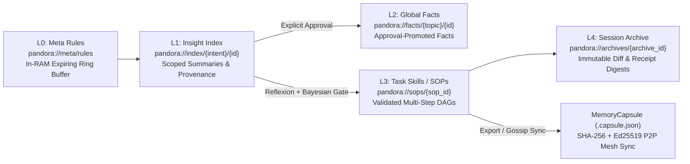

# Memory

## 5-Tier Crystallized Memory Architecture

## Shipped

`pandora-runtime::MemoryEngine` provides five crystallized memory tiers:

- `L0` (Meta Rules): An expiring in-memory trace ring buffer with a fixed capacity.
- `L1` (Insight Index): Durably stores bounded execution summaries, decisions, failures,
  benchmarks, and provenance in the scoped session database.
- `L2` (Global Facts): Durably stores only an `L1` lesson or lineage candidate promoted with
  an explicit approval record. Promoted records retain provenance and approval
  identity.
- `L3` (Task Skills / SOPs): Standard Operating Procedures representing validated, multi-step
  DAG workflows with declared trigger intents and verification checks.
- `L4` (Session Archive): Immutable records of completed session executions, summarising diff
  statistics, receipt digests, and lifecycle metadata.

Every record is scoped to a tenant, workspace, session, and provider. Recall and revocation require the exact same scope, preventing cross-workspace, cross-session, and cross-provider reuse.

Memory stores summaries rather than transcripts. Production writers emit fixed,
redacted summaries; other runtime callers must redact summaries and provenance
before storage. Secret-classified records are rejected. Raw credentials and
hidden reasoning are outside the memory contract. `forget` adds a durable
revocation tombstone and audit entry;
revoked records are excluded from recall and cannot be reinserted after record
compaction. Each scope retains at most 256 records per durable tier, and each
recall returns at most 256 records. A scope also has a lifetime ceiling of
4,096 memory identities so revocation tombstones and audit history stay
bounded after repeated compaction.

Compaction removes revoked logical records while retaining tombstones and audit
entries. It is not a secure-erasure guarantee for SQLite database pages, WAL
files, backups, or storage snapshots.

The session schema migrates existing canonical L1 execution evidence into the
durable memory tables. Migration preserves IDs, provider scope, timestamps,
summaries, and provenance. Invalid rows, invalid limits, and scope mismatches
fail closed. SQLite migration 9 partitions records by intent (`repo`, `procedure`,
`coding`, `user`), backfills existing entries from their record kind, and indexes
them via `memory_records_intent_idx` for bounded, domain-isolated recall.
SQLite migration 10 expands the memory tier constraint to `('l0', 'l1', 'l2', 'l3', 'l4')`,
introduces `sop` and `session_archive` memory kinds, updates memory audit logging, and adds
dedicated tables `memory_sops` and `memory_archives` with compound indexes (`idx_memory_sops_intent`,
`idx_memory_archives_created`) for fast scoped queries.

## Verified synthesis

`MemoryEngine::synthesis_snapshot` creates a deterministic, scope-bound view of
up to 16 eligible L1 records. Sensitive records are excluded, evidence is
sorted by stable identity, and the snapshot exposes a digest without exposing
raw content through the digest itself. `propose_synthesis` accepts a bounded,
caller-supplied redacted summary and cites every source record by ID.

`verify_synthesis` re-reads the same scope before a candidate is committed.
`commit_synthesis` performs that check while holding the engine's mutation gate,
then stores the candidate as a synthesized L1 record with its evidence IDs and
snapshot provenance. Any changed, revoked, expired, or missing source returns
`SynthesisStale`; an empty source set cannot produce a candidate. Synthesis does
not write L2, approve memory, alter policy, or grant effect authority. L2
promotion still requires the existing explicit approval path.

Durable synthesis schedules bind a name, target memory identity, exact session
and provider scope, redacted summary, classification, and bounded interval.
Claims are worker-owned and leased. Each run takes a fresh snapshot, performs
the same stale-evidence verification, commits at most one L1 candidate, and
records its snapshot digest and resulting memory ID or bounded failure. Disabling
a schedule stops future claims without deleting its run history. No scheduled
run promotes to L2 or gains effect authority.

## Boundary

`MemoryEngine::new` remains an in-process implementation for isolated runtime
use. `MemoryEngine::open` binds L1 and L2 to the existing `sessions.sqlite3`
authority while keeping L0 in RAM. Canonical execution evidence records only
the execution ID, selected Harness and Gene, terminal status, provider scope,
timestamp, and provenance; it never stores a task, output, transcript,
credential, or hidden reasoning. A failed non-advisory evaluation may add one
canonical `L1` lesson containing only the failed evaluation kinds. Evaluator
reasons, task text, output, and credentials are excluded. Agent runs retrieve
at most eight combined execution-evidence and evaluation-lesson records from
the exact same tenant, workspace, session, and provider scope. Arbitrary
`Lesson` records do not enter agent context. Retrieved records are
non-cacheable descriptive history, never instructions or authority.

The public CLI exposes scoped L1-L4 summaries through `memory recall` (`--tier <l1|l2|l3|l4>`) and
`memory audit`. `memory recall` and `memory synthesize` accept `--intent <repo|procedure|coding|user>`
for partitioned queries and candidate tagging. `memory sop list|inspect` and `memory archive list|inspect`
provide direct inspection of crystallized SOP workflows and session archive records.
`memory vfs ls [uri]` and `memory vfs cat <uri>` provide hierarchical directory and leaf inspection
over the virtual context filesystem (`pandora://`). `memory capsule export` and `memory capsule import`
enable exporting and importing verified L3 SOP workflows into standalone `.capsule.json` packages
with cryptographic SHA-256 digest validation and author provenance.
`memory forget` requires explicit confirmation before durable
revocation, and `memory promote` requires an exact approval resolved through the
existing approval store. L0 remains process-local and is not exposed as a
durable record. These commands do not create a second memory store or bypass
Pandora's approval, permit, receipt, and event authority.

## Virtual context filesystem (`pandora://`)

`ContextVfs` resolves hierarchical virtual URIs over the crystallized memory tiers, codebase feature maps, and active skills:

- `pandora://meta/rules`: Resolves L0 constitutional boundaries and behavioral rules.
- `pandora://index/{intent}/{id}`: Resolves L1 insight index records partitioned by intent (`repo`, `procedure`, `coding`, `user`).
- `pandora://facts/{topic}/{id}`: Resolves L2 durable global facts and repository truths.
- `pandora://sops/{sop_id}`: Resolves L3 validated Standard Operating Procedure DAGs.
- `pandora://archives/{archive_id}`: Resolves L4 session archives with diff statistics and receipt digests.
- `pandora://features/{module}`: Resolves codebase feature map invariants for targeted subsystems.

Querying a directory node returns its child directory entries; querying a leaf node returns the resolved `ContextFragment`. Path traversal segments (`.` and `..`) and backslashes are rejected fail-closed to prevent escape vulnerabilities.

## Evolutionary capsule protocol

`MemoryCapsule` packages verified L3 SOP workflows into portable, cryptographically signed JSON artifacts. Each capsule binds:

1. An immutable `SopDefinition` with topologically sorted execution steps and trigger intent.
2. A cryptographic SHA-256 digest calculated over the canonical SOP payload.
3. The author identity and creation timestamp.

`memory capsule export --sop <id> --output <path>` validates the SOP before writing. `memory capsule import --file <path>` re-verifies the SHA-256 digest and validates DAG acyclicity before admitting the SOP into the workspace database. Tampered, cyclic, or self-dependent capsules fail closed.

`memory compact --before <unix-seconds>` is the explicit retention boundary for
already-revoked logical records. Its default mode reports how many exact-scope
records are eligible; `--yes` applies the same session, provider, and timestamp
boundary. The runtime retains revocation tombstones and append-only audit
evidence, so a compacted identity cannot be reinserted. Mutating compaction
requires `--yes` before applying the bounded deletion, and the TUI exposes the same
workflow as non-mutating guidance.

Logical compaction is not secure erasure. SQLite pages and WAL files may retain
recoverable bytes, and encrypted backups or storage snapshots remain separate
copies. Operators must rotate or destroy encryption keys where applicable,
expire backups under their storage policy, remove snapshots through the storage
provider, and verify those lifecycle actions independently.

`backup lifecycle` adds a versioned evidence boundary for those external
actions. A closed provider/action matrix validates exact local filesystem, AWS
S3, Azure Blob, or Google Cloud Storage identifiers for backup expiry, snapshot
removal, and encryption-key destruction. Preview is non-mutating. `record
--yes` stores a digest-bound operator attestation in an append-only SQLite
ledger; exact retries are idempotent and conflicting evidence IDs fail closed.
The TUI documents the workflow, and the CLI lists the receipts (`pandora backup lifecycle list`).
Every view states that the runtime did not perform the provider action and does not
guarantee secure erasure.

`memory consolidate` is the explicit cross-session and cross-project boundary.
Same-workspace copies retain the existing safe default. A cross-project copy
requires exact source and target workspace IDs plus an explicit `reject` or
`keep-target` conflict rule before the dry run can start. Policy version 1
requires the same tenant and provider, distinct sessions, a non-sensitive L1
source, a new target identity, and `--yes` before a write. `reject` fails when an
active target identity exists; `keep-target` records a non-mutating outcome.
Neither rule overwrites an existing record or reuses a tombstoned identity.
Cross-tenant, cross-provider, sensitive, L2, and automatic global consolidation
remain denied.

Its approval object is an explicit memory contract; it does not replace Parliament approval or provide execution authority. Memory records do not grant permissions, activate packages, or execute tools.

## Context assembly cache

`ContextEngine` keeps up to 64 assemblies in the current process. Agent runs
also use the bounded atomic `context-cache.json` file in the configured data
directory, so eligible assemblies can survive a process restart. Each entry
must fit a 64 KiB retained-size budget. Only public or internal constitutional
and active-plan fragments are eligible. An entry matches only when its tenant,
workspace, session, provider, model, policy, projection version, token budget,
fragment contents, provenance, metadata, and expiry data match. An entry is
discarded before reuse when its context has expired or time moves backward.

Every assembly records a versioned manifest digest over the ordered fragments,
their exact content digests, trust and classification metadata, and bounded
origin references. Receipts report whether provenance is complete and whether
the operation was a cache `hit`, eligible `miss`, or policy `bypass`. A fragment
without complete origin evidence is assembled normally but cannot enter the
cache.

Sensitive, secret, retrieved, conversation, and L1 fragments bypass the cache.
The persistent cache ignores corrupt, oversized, stale, or scope-mismatched
records and never becomes an execution authority. It does not store model
responses, Tool output, Skill guidance, or L1 evidence. It saves local context
assembly work; it is not provider prompt caching, semantic caching, or evidence
of reduced token billing.
