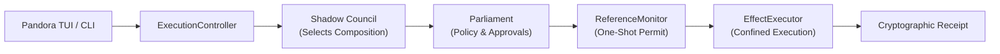

# Why Pandora?

Pandora is an open-source agent runtime for work that needs an accountable
execution boundary, not only a model that can call tools.

## The gap

Many agent CLIs focus on the conversation loop and leave authorization,
provenance, approvals, and recovery to the surrounding shell. Pandora keeps
those concerns in the runtime:

- Parliament supplies policy decisions.
- Shadow Council selects approved Harnesses, Genes, and providers.
- Harnesses compose domain behavior without becoming an authority.
- Genes request bounded work.
- ReferenceMonitor issues scoped, one-shot effect permits.
- EffectExecutor performs permitted effects and records receipts.

Learning and evolution components can propose or evaluate changes, but they
cannot issue permits, change policy roots, or activate themselves.

## What is shipped

The current `2.0.0-beta.10` line is a CLI and TUI release with:

- an interactive 4-view Ratatui TUI workbench (launched immediately via `pandora`) and 42 CLI subcommands;
- multi-provider configuration and bounded tool workflows;
- durable sessions, jobs, local subagents, and runtime service access;
- local governed MCP stdio support;
- Harness, Gene, Skill, 5-tier memory (L0-L4), graph, evaluation, and evolution contracts;
- a typed TypeScript launcher/client boundary.

Pandora does not treat a type as proof that a product feature is complete.
Release notes and tests define the supported scope. Remote
execution and marketplace distribution sit outside the shipped boundary.

## Who it is for

Pandora is for developers, researchers, and teams who need to inspect what an
agent selected, what it was allowed to do, and what result was recorded. The
same runtime can support simple local tasks and controlled workflows while
keeping policy outside the model and outside self-improvement loops.

## Evidence

- [Runtime inventory](INVENTORY.md)
- [Harness model](HARNESSES.md)
- [CLI reference](CLI.md)
- [Evaluation model](EVALUATION.md)
- [Release policy](../RELEASES.md)
- [Current changelog](../CHANGELOG.md)
- [Installation guide](INSTALL.md)
- [Repository CI](../.github/workflows/ci.yml)
- [Security policy](../SECURITY.md)
